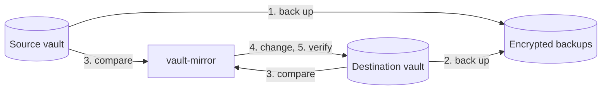

<p align="center">
  
</p>

<p align="center">
  Keeps a second Bitwarden or Vaultwarden vault in sync with your main one,<br>
  and keeps encrypted, restorable backups of both.
</p>

<p align="center">
  <a href="https://github.com/NikitaMGrimm/vault-mirror/actions/workflows/ci.yml"></a>
  <a href="https://github.com/NikitaMGrimm/vault-mirror/releases"></a>
  <a href="https://crates.io/crates/vault-mirror"></a>
  <a href="https://github.com/NikitaMGrimm/vault-mirror/pkgs/container/vault-mirror"></a>
  <a href="Cargo.toml"></a>
  <a href="LICENSE"></a>
</p>

<p align="center">
  
</p>

- **A mirror you can rely on.** Every item type, custom field, password
  history entry, passkey, folder, archive state, and attachment is copied. The
  tool re-reads the destination after every change and fails loudly if the two
  vaults differ.
- **Incremental and fast.** An unchanged vault costs two syncs and changes
  nothing on either server. A changed item is updated in place, so its id,
  and links to it, stay stable. Large first runs into Bitwarden's cloud are
  imported in bulk.
- **Complete backups.** Each run writes an [age](https://age-encryption.org)-
  encrypted snapshot of each vault, including attachment content, in
  Bitwarden's own export format. Recovering needs only the stock `age` tool.
- **Hard to misuse.** It refuses to run when source and destination look
  swapped, when a first run would delete items it did not create, or when a
  run would delete more than half the destination. The destination is backed
  up before it is changed.
- **Self-contained.** One static binary or a 14 MB container image. It speaks
  the Bitwarden API directly and needs neither the `bw` CLI nor Node.js.
  No telemetry: it talks only to your two servers and, if configured, your
  notification URL.

> [!IMPORTANT]
> vault-mirror is tested end to end against Vaultwarden and Bitwarden's own
> server, each as source and as destination, and has been run against
> Bitwarden's cloud. It handles the keys to your vault: try `check` and
> `--dry-run` first, and read [SECURITY.md](SECURITY.md).

## Contents

- [Use cases](#use-cases)
- [Install](#install)
- [Quick start](#quick-start)
- [How a run works](#how-a-run-works)
- [Configuration](#configuration)
- [Backups](#backups)
- [Commands](#commands)
- [Scheduling](#scheduling)
- [Compared with other approaches](#compared-with-other-approaches)
- [Limitations](#limitations)
- [Contributing](#contributing)

## Use cases

- **An off-site copy of a self-hosted vault.** Mirror your Vaultwarden into a
  Bitwarden cloud account, so you can still log in when your server is down.
- **Moving between servers.** Mirror from the old server to the new one until
  you switch, then stop.
- **Sharing part of a vault.** Mirror one folder, or some collections, into
  another account, such as a family member's.
- **Backups only.** Leave out the destination and get encrypted, restorable
  snapshots of one vault.

## Install

**Container image** for `linux/amd64` and `linux/arm64`:

```sh
docker pull ghcr.io/nikitamgrimm/vault-mirror:0.1
```

**Static binary** for x86-64 and arm64 Linux, from the
[releases](https://github.com/NikitaMGrimm/vault-mirror/releases). Each
release lists SHA-256 checksums, and every binary and image carries
[build provenance](https://docs.github.com/actions/security-for-github-actions/using-artifact-attestations)
that shows it was built by this repository's release workflow:

```sh
sha256sum --check --ignore-missing SHA256SUMS
gh attestation verify vault-mirror-*.tar.gz --repo NikitaMGrimm/vault-mirror
```

**From crates.io**, on Linux or macOS:

```sh
cargo binstall vault-mirror    # downloads the release binary
cargo install vault-mirror --locked
```

## Quick start

Create an API key for each account: open the web vault and go to **Settings →
Security → Keys → View API key**. Then write an env file:

```sh
# vault-mirror.env
SOURCE_SERVER=https://vault.bitwarden.com
SOURCE_CLIENT_ID=user.xxxxxxxx-xxxx-xxxx-xxxx-xxxxxxxxxxxx
SOURCE_CLIENT_SECRET=...
# The master password, to decrypt the vault.
SOURCE_PASSWORD=...

DEST_SERVER=https://vaultwarden.example.com
DEST_CLIENT_ID=user....
DEST_CLIENT_SECRET=...
DEST_PASSWORD=...

# Protects the backup key. Keep a copy somewhere other than the backups.
BACKUP_PASSPHRASE=...
SCHEDULE=0 3 * * *
TZ=Europe/Berlin
```

Use a dedicated, empty destination account. The tool deletes everything in it
that does not come from the source.

```yaml
# compose.yaml
services:
  vault-mirror:
    image: ghcr.io/nikitamgrimm/vault-mirror:0.1
    command: daemon
    env_file: vault-mirror.env
    volumes:
      - ./backups:/data
    restart: unless-stopped
```

Check the setup first. `check` logs in to both vaults and prints the plan
without writing anything:

```sh
docker compose run --rm vault-mirror check
docker compose up -d
```

The binary reads the same environment variables, for example with
`set -a; . ./vault-mirror.env; set +a; vault-mirror check`. It keeps its
backups in `./backups` unless `BACKUPS_DIR` is set.

## How a run works



1. **Source backup.** Log in to the source and back it up with its attachments.
2. **Destination backup.** Log in to the destination and back it up with its
   attachments, so anything the mirror deletes or replaces can be restored.
3. **Plan.** Compare the two vaults and check the plan against the safety
   rules.
4. **Change the destination.**
   - Create folders and collections.
   - Create and update items.
   - Copy attachments that are new or changed.
   - Delete what is no longer in the source.
5. **Verify.** Read the destination again and compare it with the source,
   including a SHA-256 of every copied attachment.
6. **Report.** Write `last-run.json` and send the notification, if one is
   configured.

If any step fails, the run stops there. A failed backup means the destination
is not touched.

Each mirrored item carries a hidden custom field, `__source`. It holds:

- the id of the source item;
- a hash of the item's content;
- a hash of its attachments.

The field links each copy to its original, so a later run knows exactly what
changed. The field holds no secrets. The comparison uses the decrypted content
itself, not only the hash, so an edit made directly in the destination is
undone on the next run.

### Safety rules

| Situation | Behavior | Override |
| --- | --- | --- |
| Source items carry `__source` markers: source and destination look swapped | Refuses | none |
| Source and destination are the same vault | Refuses | none |
| The destination has items, none of which this tool created (a first run) | Refuses | `--allow-initial-overwrite` |
| The run would delete more than `MAX_DELETE_PERCENT` of the destination, and more than 10 items | Refuses | `--allow-mass-delete` |

Deletions in the destination are permanent. They do not go to the trash. The
destination snapshot taken earlier in the same run keeps a copy.

## Configuration

All configuration comes from environment variables. You can pass any secret
as a file instead: set `NAME_FILE` to a path and the file's content is used,
which suits Docker and systemd credentials. Passwords and passphrases are
used exactly as given, spaces included; a file's final newline is dropped.

| Variable | Default | Meaning |
| --- | --- | --- |
| `SOURCE_SERVER` | required | Server URL. `https://vault.bitwarden.com` and `https://vault.bitwarden.eu` select Bitwarden's cloud. |
| `SOURCE_CLIENT_ID`, `SOURCE_CLIENT_SECRET` | required | Personal API key. |
| `SOURCE_PASSWORD` | required | Master password. |
| `SOURCE_ORGANIZATION_ID` | — | Mirror this organization instead of the personal vault; see [Organizations](#organizations). |
| `DEST_SERVER`, `DEST_CLIENT_ID`, `DEST_CLIENT_SECRET`, `DEST_PASSWORD`, `DEST_ORGANIZATION_ID` | — | The destination, in the same form as the source. Without a destination, runs only back up the source. Organizations are mirrored to organizations: set both organization ids or neither. |
| `INCLUDE_FOLDERS`, `EXCLUDE_FOLDERS` | — | Comma-separated folder names; see [Mirroring part of a vault](#mirroring-part-of-a-vault). |
| `INCLUDE_COLLECTIONS`, `EXCLUDE_COLLECTIONS` | — | The same for collections, in organization mode. |
| `BACKUP_PASSPHRASE` | — | Passphrase that protects the backup key. Either this or `BACKUP_RECIPIENTS` is required while backups are on. `ENCRYPTION_PASSWORD` is accepted as an older name. |
| `BACKUP_RECIPIENTS` | — | age public keys (`age1…`), separated by commas or spaces, to encrypt backups to instead. Restoring then needs `--identity`. |
| `BACKUP_ENABLED` | `true` | Set `false` to mirror without backups. |
| `BACKUP_ATTACHMENTS` | `true` | Store attachment content in backups. |
| `ENABLE_PRUNING` | `true` | Delete old snapshots. |
| `RETENTION_DAYS` | `30` | Age after which snapshots are deleted… |
| `MIN_FILES` | `10` | …except the newest this many, per vault. |
| `BACKUPS_DIR` | `backups` (`/data` in the image) | Where backups and `last-run.json` are kept. |
| `MAX_DELETE_PERCENT` | `50` | Mass-deletion limit; see [Safety rules](#safety-rules). |
| `CONCURRENCY` | `4` | Parallel item writes, 1–32. |
| `VERIFY_ATTACHMENTS` | `true` | Download copied attachments again and compare their SHA-256. |
| `SCHEDULE` | — | Cron expression for `daemon`, such as `0 3 * * *`. `CRON_SCHEDULE` is accepted as an older name. |
| `INTERVAL` | — | Alternative to `SCHEDULE`, such as `30m`, `6h`, or `1d`. With an interval, the first run starts immediately. |
| `TZ` | UTC | Time zone for `SCHEDULE`. |
| `NOTIFY_SUCCESS_URL`, `NOTIFY_FAILURE_URL` | — | URL that receives a one-line summary by `POST` after each run. Works with [ntfy](https://ntfy.sh), [healthchecks.io](https://healthchecks.io), Gotify webhooks, and similar services. The summary never contains vault data. |
| `CA_CERT_FILE` | — | PEM file with additional trusted certificate authorities, for servers with a private CA. |
| `BITWARDEN_CLIENT_VERSION` | a recent CLI version | Client version reported to the server. Change it only if a server rejects the default. |

`SOURCE_ACCOUNT`, `DEST_ACCOUNT`, `PUID`, `PGID`, `TEMP_DIR`, and
`DEST_DELETE_WORKERS` belong to earlier tools. They are accepted and ignored.

### Organizations

Set `SOURCE_ORGANIZATION_ID` and `DEST_ORGANIZATION_ID` to mirror one
organization into another. The organization id is in the web vault's address
when the organization is open. Bitwarden's servers show an owner only the
collections they are assigned to, and no item outside a collection. So that
nothing looks deleted, the run stops unless the account can see everything:

- Make the account an **owner** or **admin** of both organizations.
- Assign it to every collection, with **Can manage** permission.
- Put every item in a collection.

Members, groups, permissions, favorites, and folders are not mirrored.

### Mirroring part of a vault

```sh
# Only these folders and their subfolders...
INCLUDE_FOLDERS=Work, Family
# ...except these.
EXCLUDE_FOLDERS=Work/Private
```

- A name includes its subfolders, so `Work` covers `Work/Infra`.
- With `INCLUDE_FOLDERS`, items in no folder are not mirrored.
- A name that matches no folder produces a warning.
- When the filter changes, the destination follows: copies the filter no
  longer selects are deleted, within the [safety rules](#safety-rules).
- Backups always hold the whole vault.

`INCLUDE_COLLECTIONS` and `EXCLUDE_COLLECTIONS` work the same way for
organizations. An item in an excluded collection is left out even if it is
also in an included one.

## Backups

```text
backups/
├── key.age                         # backup key, encrypted with BACKUP_PASSPHRASE
├── last-run.json                   # result of the last run; no vault data
├── run.lock                        # held while a run uses this directory
├── source/
│   ├── snapshots/
│   │   ├── vault-20261014T030000Z.json.age
│   │   └── vault-20261014T030000Z.meta.json   # item count and attachment ids; no vault data
│   └── attachments/
│       └── <attachment id>.age
└── dest/
    └── …
```

- **Key.** On first use, the tool generates an age key. It is stored only in
  `key.age`, encrypted with your passphrase. Changing `BACKUP_PASSPHRASE`
  later does not re-encrypt `key.age`. Keep the old passphrase, or start a
  new backup directory.
- **Snapshots.** Each snapshot is a complete vault export with all secrets in
  the clear, encrypted as a whole. A snapshot is only written when the vault
  changed since the last one.
- **Attachments.** Each attachment is stored once, however many snapshots
  refer to it. Pruning deletes attachments that no remaining snapshot needs.
  Each vault's backups hold their own attachments, so a mirrored attachment is
  stored twice: once for the source and once for the destination.

### Recovering without vault-mirror

Only the standard [`age`](https://github.com/FiloSottile/age) tool and your
passphrase are needed:

```sh
age -d -i backups/key.age backups/source/snapshots/vault-20261014T030000Z.json.age > vault.json
age -d -i backups/key.age backups/source/attachments/<attachment id>.age > attachment.bin
```

`age` asks for the passphrase to unlock `key.age`. `vault.json` imports into
any Bitwarden client: **Import data → Bitwarden (json)**. The
`vaultMirror.attachments` list inside it maps each attachment id to its item
and file name.

### Restoring with vault-mirror

```sh
vault-mirror snapshots                       # list the source vault's snapshots
vault-mirror export --output ./recovered     # newest snapshot as export.json plus attachment files, in the clear
vault-mirror restore --to dest               # write the newest source snapshot into the destination vault
```

`restore` writes into one of the configured vaults:

- It recreates folders, collections, items, archive state, and attachments.
- By default it refuses a vault that already has items. Pass
  `--allow-non-empty` to add the items anyway.
- `--from dest` reads the destination's backups instead of the source's.
- `--snapshot NAME` picks a snapshot other than the newest, by the name
  `snapshots` lists.

## Commands

| Command | Does |
| --- | --- |
| `vault-mirror` or `vault-mirror run` | One run. Flags: `--dry-run`, `--allow-initial-overwrite`, `--allow-mass-delete`. |
| `vault-mirror daemon` | Runs on `SCHEDULE` or every `INTERVAL`, and stops cleanly on `SIGTERM` between runs. |
| `vault-mirror check` | Logs in, counts items, and prints the plan. Writes nothing. |
| `vault-mirror snapshots [--from dest]` | Lists snapshots. |
| `vault-mirror export --output DIR` | Decrypts a snapshot and its attachments into `DIR`. |
| `vault-mirror restore --to source\|dest` | Writes a snapshot into a vault. |
| `vault-mirror healthcheck [--max-age-hours 26]` | Exits non-zero unless the last run succeeded within the given time. The image uses it as its health check. |

A dry run makes backups and prints the plan, but does not change the
destination.

## Scheduling

Either let the container run `daemon`, as in the quick start, or have your
scheduler start a single run. Only one run at a time can use a backup
directory: a run that starts while another is still going fails without
touching the vaults or the backups. A systemd example:

```ini
# /etc/systemd/system/vault-mirror.service
[Service]
Type=oneshot
ExecStart=/usr/bin/docker run --rm --env-file /etc/vault-mirror.env \
  -v /var/lib/vault-mirror:/data ghcr.io/nikitamgrimm/vault-mirror:0.1

# /etc/systemd/system/vault-mirror.timer
[Timer]
OnCalendar=*-*-* 03:00:00
RandomizedDelaySec=15m
Persistent=true

[Install]
WantedBy=timers.target
```

The container runs as user 65532. A bind-mounted backup directory must be
writable by that user, for example after `chown 65532:65532
/var/lib/vault-mirror`.

## Compared with other approaches

| | vault-mirror | Scripts around `bw export` and `bw import` | Server-side backups, such as copying Vaultwarden's data directory |
| --- | --- | --- | --- |
| Works with Bitwarden's cloud | yes | yes | no |
| Keeps a live, usable second vault | yes | yes, rebuilt on every run | no |
| Changes only what changed | yes | no | not applicable |
| Copies attachments | yes | usually not | yes |
| Readable without the server | yes, with `age` | yes, if exports are kept | no |
| Needs | one binary | the `bw` CLI and Node.js | access to the server |

## Limitations

- Sends, organization members, groups, collection permissions, and account
  settings are not mirrored.
- Items in the source's trash are not mirrored. Trashed items in the
  destination are deleted.
- Bank accounts, driver's licences and passports are new item types. Bitwarden
  shows them only to accounts it has enabled them for. Copies made in a
  destination that hides them would be invisible, so they are left out of the
  mirror, with a warning, until Bitwarden enables them.
- Archived items need a server that supports archiving. If the destination
  does not, items are mirrored unarchived, and the run reports a warning.
- Tested against Vaultwarden 1.37, Bitwarden's self-hosted server 2026.9,
  and Bitwarden's cloud.
- Bitwarden accepts attachments only from premium accounts. Into a personal
  vault without premium, everything else is mirrored and attachments are left
  out with a warning, until the account has premium.
- Bitwarden's cloud limits how fast a client may write: about 60 single item
  creations a minute. vault-mirror imports large numbers of new items in bulk
  and waits out rate limits, so a large first run takes longer but completes.
  New organization items are still created one at a time.
- Bitwarden's servers require every organization item to be in a collection.
  Source items in no collection are left out of such a destination, with a
  warning.
- Attachments are held in memory while they are copied, so a large attachment
  needs a few times its size in free memory.

## Contributing

Questions and ideas go to
[Discussions](https://github.com/NikitaMGrimm/vault-mirror/discussions),
bugs to [Issues](https://github.com/NikitaMGrimm/vault-mirror/issues), and
vulnerabilities to a [private report](SECURITY.md). Read
[CONTRIBUTING.md](CONTRIBUTING.md) before opening a pull request.

## License

[GPL-3.0-only](LICENSE). vault-mirror uses Bitwarden's `bitwarden-crypto`
crate, which is published under the GPL.

vault-mirror is an independent project, not affiliated with or endorsed by
Bitwarden, Inc. or the Vaultwarden project.
