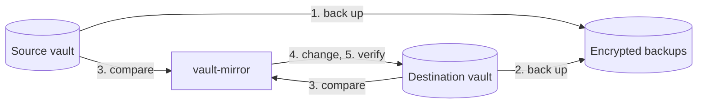

# How it works

[← Documentation](README.md)

vault-mirror makes one vault, the **destination**, match another, the
**source**. Each time it does this is called a **run**. A run either finishes
the whole job or stops with an error. It never leaves the destination half
matched without telling you, and the next run picks up where a failed one left
off.

## A run, step by step



1. **Back up the source.** It writes an encrypted **snapshot** of the source and
   stores any attachments it hasn't stored before. If the vault hasn't changed
   since the newest snapshot, no new snapshot is written.
2. **Back up the destination.** The destination is backed up too, before anything
   in it is deleted or replaced. If a run ever removes something you wanted, it's
   in this backup.
3. **Compare.** It works out what to create, update and delete, prints that plan,
   and runs the [safety checks](#safety-checks). If a check fails, the run stops
   here and the destination is untouched.
4. **Change the destination.** It creates folders or collections, creates and
   updates items, copies new or changed attachments, and finally deletes what no
   longer belongs. Deletions come last, so a run that fails partway has removed
   nothing.
5. **Verify.** It reads the destination back and compares it with the source
   again. If anything still differs, the run fails. Attachments are checked as
   they're copied: each one is downloaded again and its SHA-256 hash compared.
6. **Report.** It records the result in `last-run.json` and, if you set one,
   sends a one-line summary to your notification URL.

If backups are switched off, steps 1 and 2 are skipped. If no destination is
configured, the run stops after step 1, which makes vault-mirror a scheduled
backup tool for a single vault. A failed backup stops the run before the
destination is changed.

## How copies are recognized

Every item vault-mirror creates in the destination is a **copy**, and every copy
carries a **marker**: an extra custom field called `__source`. It's an ordinary
**Hidden** field, so Bitwarden apps show it masked until you reveal it. The
marker holds:

- the id of the source item it was copied from,
- a hash of the item's content, and
- a hash that identifies the source's attachments and their copies.

The marker contains no secrets. It's what lets later runs pair each copy with
its source item, so an edited item is updated in place rather than deleted and
created again.

The marker isn't trusted blindly: vault-mirror also compares the decrypted
content of both items. If you edit a copy directly, the next run puts the source
version back. If you remove a copy's marker, vault-mirror no longer recognizes
it, and the next run deletes it and creates a fresh copy.

## Safety checks

Before it changes anything, vault-mirror checks the plan. If a check fails, the
run stops with an error and the destination is left exactly as it was.

| The run stops when… | Because… | To go ahead anyway |
| --- | --- | --- |
| Items in the source have `__source` fields. | The source looks like a mirror, so the settings are probably swapped. | Fix the settings. There's no override. |
| The source and destination are the same vault. | The run would delete everything in it. | Fix the settings. There's no override. |
| The destination has items, and none of them are copies. | `DEST_*` probably points at an account you already use. The first run would delete its items. | `run --allow-initial-overwrite` |
| The run would delete every copy it made before. | That's what an empty or wrong source looks like: a server error, the wrong account, or a filter that matches nothing. | `run --allow-mass-delete` |
| The run would delete more than `MAX_DELETE_PERCENT` of the destination (only if you set it, above 10 deletions, once the destination has copies). | You asked for a limit. | `run --allow-mass-delete` |

The `--allow` flags apply to one run. Scheduled runs after it are checked as
usual. With Docker Compose, run one with:

```console
$ docker compose run --rm vault-mirror run --allow-mass-delete
```

### Why there's no default deletion limit

Many sync tools refuse to delete more than some fixed share of items, such as
half. vault-mirror doesn't, because the number would be arbitrary: deleting 40%
of a vault by mistake isn't safer than deleting 60%. Instead it stops on the
situation that's almost never intended, losing every copy at once, and relies on
the backup taken at the start of every run for smaller mistakes. If you'd like a
limit anyway, set `MAX_DELETE_PERCENT`.

> [!WARNING]
> vault-mirror deletes destination items permanently; they don't go to the
> trash. If you override a safety check, recovery depends on your backups, and
> for attachments on `BACKUP_ATTACHMENTS` being on (it is by default).

## Compared with other approaches

| | vault-mirror | Scripts around `bw export` and `bw import` | Copying the server's data directory |
| --- | --- | --- | --- |
| Works with Bitwarden's cloud | yes | yes | no |
| Keeps a usable second vault | yes | yes, rebuilt on every run | no |
| Changes only what changed | yes | no | not applicable |
| Copies attachments | yes | usually not | yes |
| Readable without the server | yes, with `age` | yes, if you keep the exports | no |
| Needs | one binary | the `bw` CLI and Node.js | access to the server |
