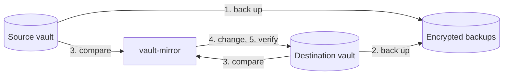

# How it works

[← Documentation](README.md)

vault-mirror makes one vault, the **destination**, match another, the
**source**. Each time it does this is a **run**. If a run fails, the next run
picks up where it left off.

## A run, step by step



1. **Back up the source** as an encrypted **snapshot**, with its attachments.
   An unchanged vault gets no new snapshot.
2. **Back up the destination** the same way.
3. **Compare.** It prints what it will create, update and delete, and runs the
   [safety checks](#safety-checks).
4. **Change the destination**: create folders or collections, create and
   update items, copy attachments, then move removed copies to the trash.
5. **Verify.** It reads the destination back and compares it with the source.
6. **Report.** It writes the result to `last-run.json` and to your notification
   URL, if you set one.

A failed step stops the run. Without a destination, the run ends after step 1.

## How copies are recognized

Each item vault-mirror creates in the destination is a **copy**. Each copy has a
**marker**: a hidden custom field called `vault-mirror`, with the source item's
id and hashes of what was copied. It holds no secrets.

Items without a marker aren't copies. vault-mirror never changes or deletes them,
or the folders and collections they're in, so you can keep your own items in the
destination.

- If you edit a copy, the next run puts the source version back and warns you.
  Your edit is in that run's destination backup.
- If you delete a copy's marker, the item is no longer a copy, and the next run
  makes a new one next to it.
- If you clone a copy and change the clone, runs warn that it still has the
  marker. Remove its `vault-mirror` field to keep it. An unchanged clone is
  removed as a duplicate.

### After an outage

The destination is there for when the source is down. If you change items in
it meanwhile, stop the daemon, so no run overwrites your changes when the
source is back:

```sh
docker compose stop vault-mirror
```

Once the source is back, pull your changes over and start the daemon again:

```sh
docker compose run --rm vault-mirror run --pull
docker compose up -d
```

A pull copies into the source every copy you changed, and every item you added
in the destination, as far as the filter selects them. Then it mirrors as usual. It deletes nothing, so an item
you deleted in the destination comes back from the source. Until a started
pull finishes, runs without `--pull` refuse to start.

### Switching the source and destination

To make the destination your main vault, swap the `SOURCE_` and `DEST_`
settings. The first run after the swap stops, because swapped settings are
usually a mistake. If you meant it, run once with `--reverse`:

```sh
docker compose run --rm vault-mirror run --reverse
```

The markers let it update the existing items instead of copying everything
again.

## Safety checks

Before it changes anything, vault-mirror checks the plan. If a check fails, the
run stops and the destination stays as it was.

| The run stops when | Likely cause | To go ahead anyway |
| --- | --- | --- |
| Items in the source are copies of destination items | Source and destination are swapped. | Fix the settings, or `run --reverse` if you [switched them on purpose](#switching-the-source-and-destination). |
| Source and destination are the same vault | A settings mistake. | Fix the settings. |
| The run would delete every copy | The source is empty, the wrong account, or filtered to nothing. | `run --allow-mass-delete` |
| The run would delete more than `MAX_DELETE_PERCENT` of the copies | You set a limit. | `run --allow-mass-delete` |

A flag applies to one run:

```sh
docker compose run --rm vault-mirror run --allow-mass-delete
```

Removed copies go to the server's trash, and the run's destination backup holds
them too.
