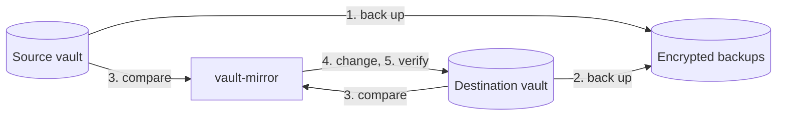

# How it works

[← Documentation](README.md)

vault-mirror copies all supported item types, custom fields, passkeys, password history entries, folders, and attachments.
[Limitations](limitations.md) lists server restrictions and data that vault-mirror does not copy.

## A run, step by step

| Stage | Action |
| --- | --- |
| 1. Source backup | vault-mirror backs up the source and its attachments. |
| 2. Destination backup | vault-mirror backs up the destination and its attachments before deleting or replacing data. |
| 3. Comparison | vault-mirror compares both vaults and runs the [safety checks](#safety-checks). |
| 4. Changes | vault-mirror creates folders and collections. vault-mirror creates and updates items. vault-mirror copies new or changed attachments. vault-mirror deletes destination data that no longer matches the source. |
| 5. Verification | vault-mirror reads the destination again and compares the data with the source. vault-mirror downloads copied attachments again and compares their SHA-256 hashes. |
| 6. Reporting | vault-mirror writes `last-run.json`. vault-mirror sends a notification when you configure a notification URL. |

These stages describe a run with backups and attachment verification enabled.
Without a destination, a run backs up only the source.

A failure stops further backup or destination changes.
vault-mirror still attempts to record the result and send the configured notification.
A failed backup prevents destination changes.

## How copies are matched

A **copy** is a destination item that vault-mirror made.
Each copy has a **marker**, the extra custom field `__source`.
The marker uses Bitwarden's **Hidden** field type.

Bitwarden shows the marker with a masked value until you reveal the value.
The marker contains these values:

- The source item's id.
- A hash of the item's content.
- A hash of the source attachments and their copies.

The marker links a copy to its source item.
The marker contains no passwords or other secret values.
vault-mirror compares decrypted content as well as the marker hashes.

vault-mirror replaces direct edits to a copy during the next run.
Keep the marker in each copy.
Without the marker, vault-mirror cannot identify the copy and plans to delete and recreate the item.

## Safety checks

vault-mirror checks the plan before changing the destination.
A failed safety check stops destination changes with an error.
Safety check failures are errors.

| Stop condition | Reason | Override |
| --- | --- | --- |
| Source items have `__source` fields. | The source might be a destination from an earlier run. vault-mirror could overwrite your vault with copies. | None. |
| Source and destination are the same vault. | The run could delete all items. | None. |
| The destination contains items, with no recognized copies. | The `DEST_*` settings select a destination with items that have no recognized markers. The run would delete those items. | `run --allow-initial-overwrite`, for one run. |
| The plan deletes every earlier copy. | The source appears empty or different. Possible causes include a server error, a wrong account, or a filter that selects nothing. Earlier copies preserve your data. | `run --allow-mass-delete`, for one run. |
| Deletions exceed `MAX_DELETE_PERCENT` and 10 items, with at least one recognized copy in the destination. | You set a percentage limit for destination item deletions. | `run --allow-mass-delete`, for one run. |

The percentage check excludes duplicate copies from its deletion count.

vault-mirror has no default percentage limit for deletions.
A fixed percentage cannot distinguish intended deletions from mistakes.
With backups enabled, the run backs up data before deleting items.

> [!WARNING]
> vault-mirror permanently deletes destination items.
> Deleted items do not enter the trash.
> An override permits the deletions that the corresponding safety check blocks.
> Backups preserve deleted data only when you enable backups and the required attachment content.

Run an override for one container run with `docker compose run --rm vault-mirror run --allow-mass-delete`.
Scheduled runs then continue with the usual safety checks.

## Compared with other approaches

| | vault-mirror | Scripts around `bw export` and `bw import` | Server-side backups, such as copying Vaultwarden's data directory |
| --- | --- | --- | --- |
| Works with Bitwarden's cloud | yes | yes | no |
| Keeps a usable destination vault | yes | yes, rebuilt on every run | no |
| Updates only changed data | yes | no | not applicable |
| Copies attachments | yes | usually no | yes |
| Readable without the server | yes, with `age` | yes, if you keep exports | no |
| Requirements | one binary | the `bw` CLI and Node.js | access to the server |
