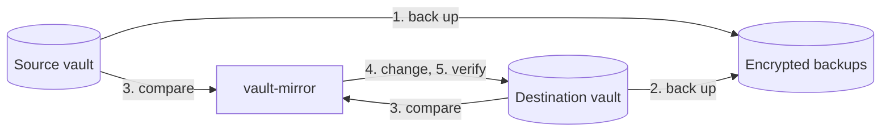

# How it works

[← Documentation](README.md)

vault-mirror makes one vault, the **destination**, match another, the
**source**. Each time it does this is a **run**. If a run fails, the next run
picks up where it left off.

## A run, step by step



1. **Back up the source.** It saves an encrypted **snapshot** of the source
   with its own attachment files. It skips a vault unchanged since its newest
   snapshot.
2. **Back up the destination**, the same way. Anything the run removes later is
   in this backup.
3. **Compare.** It works out what to create, update and delete, prints that
   plan, and runs the [safety checks](#safety-checks). If a check fails, the run
   stops here.
4. **Change the destination**, in this order:
   - create folders or collections,
   - create and update items,
   - copy new or changed attachments,
   - move copies whose source item is gone to the trash.
5. **Verify.** It reads the destination back and compares it with the source.
   Each copied attachment is downloaded again and compared before any file it
   replaces is removed.
6. **Report.** It writes the result to `last-run.json` and sends it to your
   notification URL, if you set one.

A failed backup stops the run before the destination changes. Without a
destination, the run stops after step 1.

Item removals come last. Replacement attachments are uploaded and checked
before the captured old files are removed. A failed upload keeps those old
files. The backup from step 2 holds the earlier state.

## How copies are recognized

Each item vault-mirror creates in the destination is a **copy**. Each copy has a
**marker**: a hidden custom field called `vault-mirror`. It holds:

- the id of the source item,
- a hash of the item's content when vault-mirror last wrote it,
- a hash of the source item's attachments when they were copied,
- a hash of the copy's attachments as vault-mirror left them.

The marker holds no secrets. It lets the next run update a copy in place instead
of deleting and recreating it.

Items without a marker aren't copies. vault-mirror never changes or deletes them,
or the folders and collections they're in. So you can keep your own items in the
destination, and anything you add there while the source is unreachable stays.

vault-mirror also compares the content itself, so:

- if you edit a copy or its attachments, the next run puts the source version
  back and warns you; with backups on, your edit is in that run's destination
  backup. Archiving a copy is undone too, without a warning, because servers
  that can't archive would otherwise warn on every run;
- if you delete a copy's marker, the item is no longer a copy, and the next run
  makes a new one next to it;
- if you clone a copy and change the clone, runs leave the clone alone and warn
  that it still has the marker. Remove the `vault-mirror` field from it to keep
  it for good; otherwise it is deleted with its source item.

### After an outage

The destination is there for when the source is down. If you add or change
items in it meanwhile, stop the daemon first, so that no run overwrites your
changes as soon as the source is back:

```sh
docker compose stop vault-mirror
```

Once the source is back, bring your changes over with one pull, and start the
daemon again:

```sh
docker compose run --rm vault-mirror run --pull
docker compose up -d
```

After backing up both vaults, the pull copies into the source:

- every copy you changed, over its source item, with a warning if that
  changed too. Its folder comes along; its collections don't. A copy whose
  source item is gone is added back.
- every item vault-mirror didn't make, in a folder or collections of the same
  name.

Then it mirrors as usual. A pull deletes nothing, so an item you deleted in
the destination comes back from the source. With a filter, only what the
filter selects is pulled. If a pull stops partway, runs without `--pull`
refuse to start until one finishes.

### Switching the source and destination

To make the destination your main vault for good, swap the `SOURCE_` and `DEST_`
settings. The new source's items are copies, and their markers name the items
they came from, so vault-mirror can update those items in place instead of
making new ones. The first run after the swap stops, because swapped settings
are usually a mistake. If you meant it, run once with `--reverse`:

```sh
docker compose run --rm vault-mirror run --reverse
```

Changes made in the new destination since its last run as the source are
replaced, with a warning, and are in that run's backup. Items you deleted in the
new source stay in the new destination, with a warning, because nothing marks
them as copies. Attachments that still match on both sides aren't copied
again. After that, either direction runs without `--reverse`. If items were
added since the last switch, switching back stops once more, for those items.

## Safety checks

Before it changes anything, vault-mirror checks the plan. If a check fails, the
run stops and the destination stays as it was.

| The run stops when | Likely cause | To go ahead anyway |
| --- | --- | --- |
| Items in the source are copies of destination items | Source and destination are swapped. | Fix the settings, or `run --reverse` if you [switched them on purpose](#switching-the-source-and-destination). |
| Source and destination are the same vault | A settings mistake. | Fix the settings. |
| The run would delete every copy | The source is empty, the wrong account, or filtered to nothing. | `run --allow-mass-delete` |
| The run would delete more than `MAX_DELETE_PERCENT` of the copies | You set a limit. | `run --allow-mass-delete` |

A flag applies to one run. Later runs are checked as usual. With Docker Compose:

```sh
docker compose run --rm vault-mirror run --allow-mass-delete
```

> [!WARNING]
> Removed copies go to the server's trash. Its recovery window depends on the
> server. Keep encrypted backups too. The final read and removal are separate
> requests, so a concurrent late edit can still be moved to the trash. It is
> recoverable there, but the operation is not atomic.

## Compared with other approaches

| | vault-mirror | Scripts around `bw export` and `bw import` | Copying the server's data directory |
| --- | --- | --- | --- |
| Works with Bitwarden's cloud | yes | yes | no |
| Keeps a usable second vault | yes | yes, rebuilt on every run | no |
| Changes only what changed | yes | no | not applicable |
| Copies attachments | yes | usually not | yes |
| Readable without the server | yes, with `age` | yes, if you keep the exports | no |
| Needs | one binary | the `bw` CLI and Node.js | access to the server |
