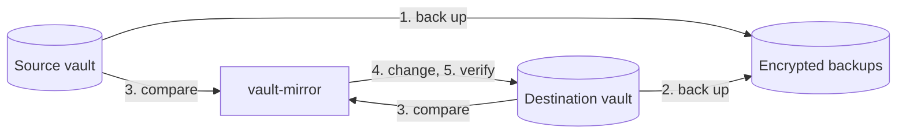

# How it works

[← Documentation](README.md)

vault-mirror copies items between two vaults.
The source is the vault to copy.
The destination receives the copies.

The tool copies every item type, custom field, passkey, password history entry, folder, and attachment, subject to [server limitations](limitations.md).

## A run, step by step

A run is one execution of vault-mirror.
With backups enabled, it keeps snapshots of both configured vaults.
Each snapshot is one encrypted backup file.

The tool completes these stages:

| Stage | Action |
| --- | --- |
| 1. Source backup | It backs up the source and its attachments. |
| 2. Destination backup | It backs up the destination and its attachments before deleting or replacing data. These backups let you restore that data. |
| 3. Comparison | It compares both vaults and runs the [safety checks](#safety-checks). |
| 4. Changes | It creates folders and collections. It creates and updates items. It copies new or changed attachments. It deletes destination data that no longer matches the source. |
| 5. Verification | It reads the destination again and compares the data with the source. It downloads copied attachments again and compares their SHA-256 hashes. |
| 6. Reporting | It writes `last-run.json`. It sends a notification when you configure a notification URL. |

These stages describe a run with backups and attachment verification enabled.
Without a destination, a run backs up only the source.

A failure stops further backup or destination changes.
The tool still attempts to record the result and send the configured notification.
A failed backup prevents destination changes.

## How copies are matched

A copy is a destination item that vault-mirror made.
Each copy has a marker, the extra custom field `__source`.
The marker uses Bitwarden's ordinary **Hidden** field type.

Bitwarden shows the marker in the item with a masked value until you reveal it.
The marker contains these values:

- The source item's id.
- A hash of the item's content.
- A hash of the source attachments and their copies.

The marker links a copy to its source item, so later runs can identify changes.
It contains no secrets.
The tool compares decrypted content as well as marker hashes.

It replaces direct edits to a copy during the next run.
Keep the marker in each copy.
Without the marker, the tool cannot identify the copy and plans to delete and recreate the item.

## Safety checks

vault-mirror checks the plan before changing the destination.
A failed check stops the run with an error and leaves the destination unchanged.
These failures are errors, not warnings.

| Stop condition | Reason | Override |
| --- | --- | --- |
| Source items have `__source` fields. | Source and destination may be swapped. The run would overwrite your vault with copies. | None. |
| Source and destination are the same vault. | The run would delete all items. | None. |
| The destination contains items, with no recognized copies. | `DEST_*` may select an account that you already use. The run would delete its existing items. | `run --allow-initial-overwrite`, for one run. |
| The plan deletes every earlier copy. | The source appears empty or different. Possible causes include a server error, a wrong account, or a filter that selects nothing. The destination preserves your data when the source fails. | `run --allow-mass-delete`, for one run. |
| Deletions exceed `MAX_DELETE_PERCENT` and 10 items, with at least one recognized copy in the destination. | You set a percentage limit for destination item deletions. | `run --allow-mass-delete`, for one run. |

The percentage check excludes duplicate copies from its deletion count.

There is no default percentage limit for deletions.
A fixed percentage is arbitrary: accidentally deleting 40% of a vault is no safer than deleting 60%.
With backups enabled, each run preserves data before deletion.
These backups also protect data after smaller deletion mistakes.

> [!WARNING]
> vault-mirror permanently deletes destination items without using the trash.
> Overrides permit deletions that safety checks block.
> Recovery requires enabled backups.
> Restoring attachments also requires stored attachment content.

Run an override for one container run with `docker compose run --rm vault-mirror run --allow-mass-delete`.
Scheduled runs then continue with the usual safety checks.

## Compared with other approaches

| | vault-mirror | Scripts around `bw export` and `bw import` | Server-side backups, such as copying Vaultwarden's data directory |
| --- | --- | --- | --- |
| Works with Bitwarden's cloud | yes | yes | no |
| Keeps a live, usable destination vault | yes | yes, rebuilt on every run | no |
| Updates only changed data | yes | no | not applicable |
| Copies attachments | yes | usually no | yes |
| Readable without the server | yes, with `age` | yes, if you keep exports | no |
| Requirements | one binary | the `bw` CLI and Node.js | access to the server |
