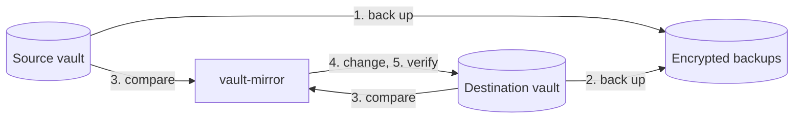

# How it works

[← Documentation](README.md)

vault-mirror makes one vault, the **destination**, match another, the
**source**. Each time it does this is a **run**. If a run fails, the next run
picks up where it left off.

## A run, step by step



1. **Back up the source.** It saves an encrypted **snapshot** of the source,
   plus any attachments it hasn't stored yet. If nothing changed since the last
   snapshot, it skips the snapshot.
2. **Back up the destination**, the same way. Anything the run removes later is
   in this backup.
3. **Compare.** It works out what to create, update and delete, prints that
   plan, and runs the [safety checks](#safety-checks). If a check fails, the run
   stops here.
4. **Change the destination**, in this order:
   - create folders or collections,
   - create and update items,
   - copy new or changed attachments,
   - delete copies whose source item is gone.
5. **Verify.** It reads the destination back and compares it with the source.
   Each copied attachment was already downloaded again and checked by its
   SHA-256 hash.
6. **Report.** It writes the result to `last-run.json` and sends it to your
   notification URL, if you set one.

A failed backup stops the run before the destination changes. Without backups,
steps 1 and 2 are skipped. Without a destination, the run stops after step 1.

Because item deletions come last, a run that fails while writing hasn't deleted
any items. Changed attachments are the exception: the old file is removed before
the new one is uploaded. Either way, the backup from step 2 has the earlier
state.

## How copies are recognized

Each item vault-mirror creates in the destination is a **copy**. Each copy has a
**marker**: a hidden custom field called `__source`. It holds:

- the id of the source item,
- a hash of the item's content,
- a hash of its attachments.

The marker holds no secrets. It lets the next run update a copy in place instead
of deleting and recreating it.

Items without a marker aren't copies. vault-mirror never changes or deletes them,
or the folders and collections they're in. So you can keep your own items in the
destination, and anything you add there while the source is unreachable stays.

vault-mirror also compares the content itself, so:

- if you edit a copy, the next run puts the source version back and warns you;
  with backups on, your edit is in that run's destination backup. An
  attachment you add to a copy, or archiving it, is undone the same way but
  without the warning: the marker can't tell whether that change came from
  the source or the destination;
- if you delete a copy's marker, the item is no longer a copy, and the next run
  makes a new one next to it.

## Safety checks

Before it changes anything, vault-mirror checks the plan. If a check fails, the
run stops and the destination stays as it was.

| The run stops when | Likely cause | To go ahead anyway |
| --- | --- | --- |
| Source items have a `__source` field | Source and destination are swapped. | Fix the settings. |
| Source and destination are the same vault | A settings mistake. | Fix the settings. |
| The run would delete every copy | The source is empty, the wrong account, or filtered to nothing. | `run --allow-mass-delete` |
| The run would delete more than `MAX_DELETE_PERCENT` of the copies | You set a limit. | `run --allow-mass-delete` |

`MAX_DELETE_PERCENT` is off unless you set it. It applies only above 10
deletions, and only once the destination has copies. Extra copies of the same
source item are always deleted and don't count towards it.

A flag applies to one run. Later runs are checked as usual. With Docker Compose:

```sh
docker compose run --rm vault-mirror run --allow-mass-delete
```

> [!WARNING]
> Deleted copies don't go to the trash. After an override, only your backups can
> bring them back.

### Why there's no default deletion limit

Any fixed limit would be arbitrary: deleting 40% of a vault by mistake isn't
safer than deleting 60%. So vault-mirror only stops on the case that's almost
never intended, losing every copy at once. For smaller mistakes, there's the
backup from the start of each run. To set a limit anyway, use
`MAX_DELETE_PERCENT`.

## Compared with other approaches

| | vault-mirror | Scripts around `bw export` and `bw import` | Copying the server's data directory |
| --- | --- | --- | --- |
| Works with Bitwarden's cloud | yes | yes | no |
| Keeps a usable second vault | yes | yes, rebuilt on every run | no |
| Changes only what changed | yes | no | not applicable |
| Copies attachments | yes | usually not | yes |
| Readable without the server | yes, with `age` | yes, if you keep the exports | no |
| Needs | one binary | the `bw` CLI and Node.js | access to the server |
