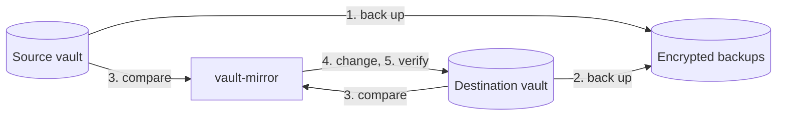

# How it works

[← Documentation](README.md)

## A run, step by step

1. **Source backup.** Log in to the source and back it up with its attachments.
2. **Destination backup.** Log in to the destination and back it up with its
   attachments, so anything the mirror deletes or replaces can be restored.
3. **Plan.** Compare the two vaults and run the
   [safety checks](#safety-checks).
4. **Change the destination.**
   - Create folders and collections.
   - Create and update items.
   - Copy attachments that are new or changed.
   - Delete what is no longer in the source.
5. **Verify.** Read the destination again and compare it with the source,
   including a SHA-256 of every copied attachment.
6. **Report.** Write `last-run.json` and send the notification, if one is
   configured.

If any step fails, the run stops there. A failed backup means the destination
is not touched.

## How copies are matched

Each copy in the destination gets one extra custom field, `__source`. It is
an ordinary field of Bitwarden's **Hidden** type: you see it in the item,
with its value masked until you reveal it. The value holds:

- the id of the source item;
- a hash of the item's content;
- a hash of its attachments and of their copies.

The field links each copy to its original, so a later run knows exactly what
changed. It holds no secrets. Changes are found by comparing the decrypted
content itself, not only the hash, so an edit made directly in a copy is
undone on the next run. Leave the field in place: without it, a copy is no
longer recognised and is deleted and created again.

## Safety checks

A run checks its plan before it changes anything. If a check fails, the run
stops with an error and leaves the destination as it was. None of these are
warnings.

| The run stops when | Because | To go ahead |
| --- | --- | --- |
| Source items carry `__source` fields | Source and destination are probably swapped, and the run would overwrite your vault with its copy. | Not possible. |
| Source and destination are the same vault | The run would delete everything. | Not possible. |
| The destination holds items, none of them created by vault-mirror | `DEST_*` probably points at an account in use. Its items would be deleted. | `run --allow-initial-overwrite`, once. |
| The run would delete more than `MAX_DELETE_PERCENT` (default 50) of the destination's items, and more than 10 | The source probably looks emptier than it is: a wrong account, a server problem, or a mistyped filter. The copy is what you fall back on then. | `run --allow-mass-delete`, once, or a higher `MAX_DELETE_PERCENT`. `100` turns this check off. |

With the container, run the override once by hand, for example
`docker compose run --rm vault-mirror run --allow-mass-delete`. Scheduled
runs then continue normally.

Deletions in the destination are permanent; they do not go to the trash. The
backup the same run took beforehand keeps a copy of everything it deletes.

## Compared with other approaches

| | vault-mirror | Scripts around `bw export` and `bw import` | Server-side backups, such as copying Vaultwarden's data directory |
| --- | --- | --- | --- |
| Works with Bitwarden's cloud | yes | yes | no |
| Keeps a live, usable second vault | yes | yes, rebuilt on every run | no |
| Changes only what changed | yes | no | not applicable |
| Copies attachments | yes | usually not | yes |
| Readable without the server | yes, with `age` | yes, if exports are kept | no |
| Needs | one binary | the `bw` CLI and Node.js | access to the server |
